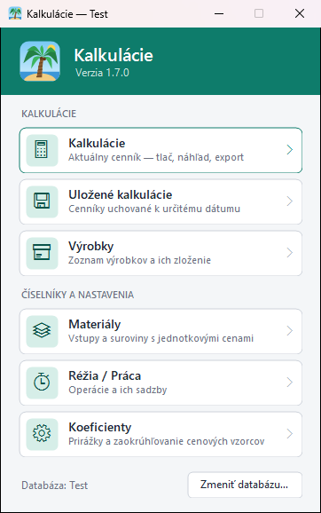
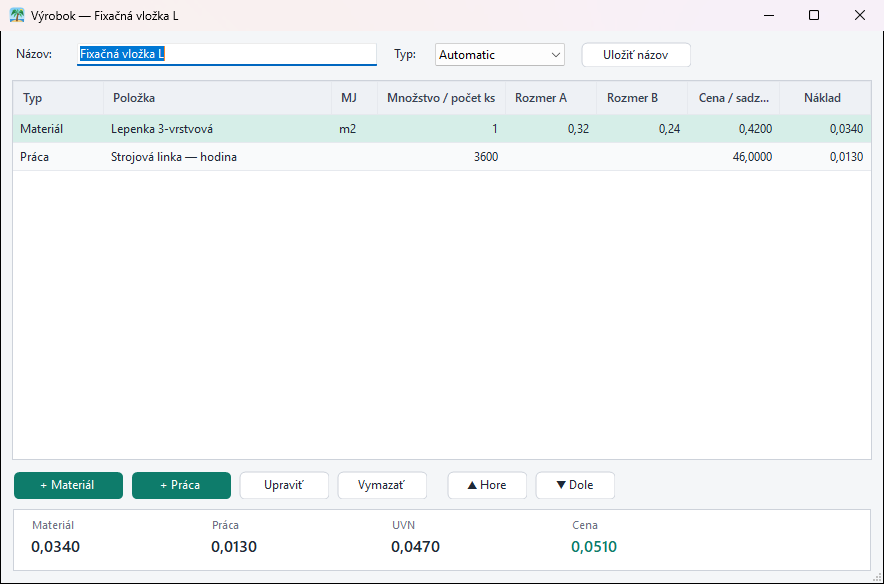
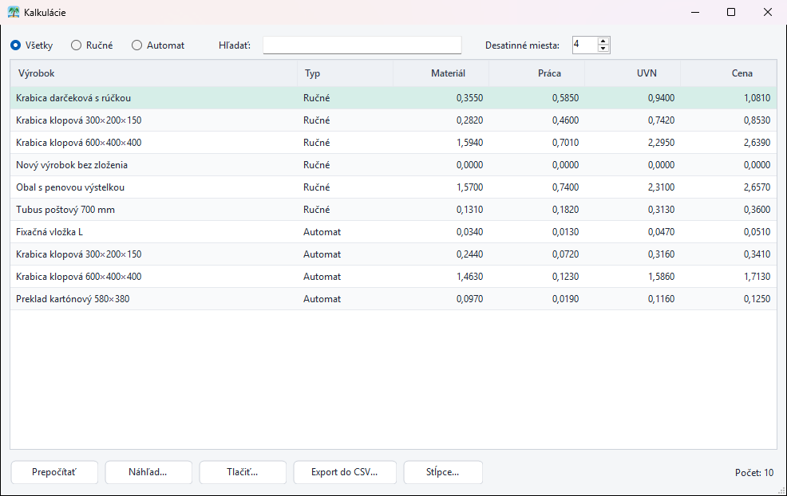
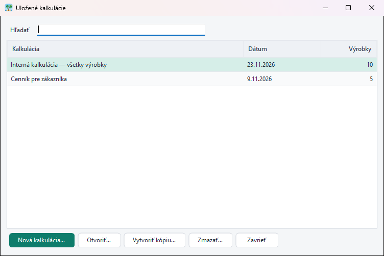
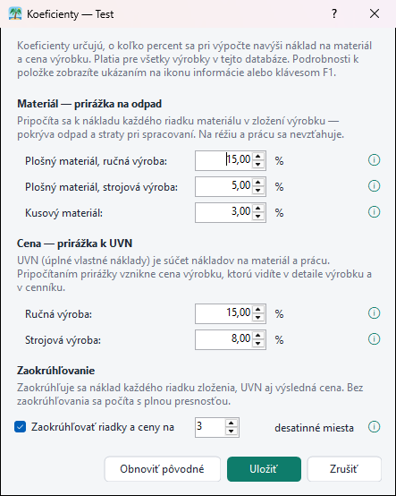

<p align="center">
  
</p>

<h1 align="center">Kalkulácie</h1>

<p align="center">
  <a href="https://github.com/oprencak/kalkulacie/releases/latest"></a>
  
  
</p>

Kalkulačný a cenníkový program pre výrobnú firmu. Z ceny materiálov, sadzieb práce a zloženia výrobku
vypočíta jeho nákladovú a predajnú cenu.

Je to prepis pôvodnej FoxPro aplikácie, ktorá bola v prevádzke od roku 1997, do .NET (WinForms + SQLite).
Cenové vzorce sú prevzaté z originálu.

<p align="center">
  
</p>

## Obsah

- [Čo program vie](#čo-program-vie)
- [Inštalácia](#inštalácia)
- [Návod na používanie](#návod-na-používanie)
- [Ako sa počíta cena](#ako-sa-počíta-cena)
- [Dáta a zálohy](#dáta-a-zálohy)
- [Aktualizácia](#aktualizácia)
- [Pre vývojárov](#pre-vývojárov)

## Čo program vie

- **Materiály** — vstupy a suroviny s jednotkou a jednotkovou cenou
- **Réžia / práca** — operácie so sadzbami
- **Výrobky** — ručná alebo strojová (automatická) výroba; každý výrobok má zloženie z materiálov a réžií
- **Kalkulácie** — aktuálny cenník všetkých výrobkov: filter, hľadanie, tlač, náhľad, export do CSV,
  výber stĺpcov
- **Uložené kalkulácie** — cenník uchovaný k určitému dátumu, ktorý sa nezmení, keď sa neskôr zmenia ceny
- **Koeficienty** — prirážky a zaokrúhľovanie cenových vzorcov, nastaviteľné bez zásahu do programu
- **Viac databáz** — napríklad ostrá a skúšobná; výber pri štarte
- **Automatické zálohy** a **aktualizácia** jedným kliknutím

## Inštalácia

Program sa neinštaluje a nepotrebuje .NET ani nič ďalšie.

1. Z [poslednej verzie](https://github.com/oprencak/kalkulacie/releases/latest) stiahnite `Kalkulacie.App.exe`.
2. Uložte ho do vlastného priečinka, kam máte právo zápisu (napr. `C:\Kalkulacie`) — nie do `Program Files`.
3. Spustite ho. Pri prvom štarte si vytvoríte databázu; uloží sa do priečinka `data\` vedľa exe.

Požiadavky: Windows 10 alebo 11, 64-bit.

> Windows môže pri prvom spustení zobraziť upozornenie SmartScreen, pretože exe nie je digitálne podpísané.
> Zvoľte **Ďalšie informácie → Spustiť aj tak**.

Existujúce dáta z FoxPro verzie sa prenášajú samostatným nástrojom — pozri [Import z FoxPro](#import-z-foxpro).

## Návod na používanie

Odporúčané poradie pri prázdnej databáze:

### 1. Materiály a réžie

V hlavnom menu otvorte **Materiály** a zadajte suroviny s jednotkou a cenou za jednotku. Potom v
**Réžia / Práca** zadajte operácie so sadzbami.

Materiál alebo réžiu, ktorá je použitá v niektorom výrobku, nemožno zmazať. Kde všade sa používa, ukáže
okno „Kde sa používa“.

### 2. Výrobky a zloženie

V **Výrobky** vytvorte výrobok a zvoľte typ výroby (ručná / automat). V detaile výrobku pridávajte riadky zloženia:

| Riadok | Čo sa zadáva |
|---|---|
| Materiál plošný | materiál, rozmery A a B, množstvo |
| Materiál kusový | materiál a množstvo (rozmery ostanú prázdne) |
| Réžia | operácia a **počet kusov**, ktorým sa sadzba delí |

Poradie riadkov meníte tlačidlami Hore / Dole. Zmeny v zložení sa ukladajú hneď, cena sa prepočíta okamžite.
Podobný výrobok najrýchlejšie vytvoríte kopírovaním existujúceho.



### 3. Cenník

**Kalkulácie** zobrazia aktuálne ceny všetkých výrobkov. Zoznam možno filtrovať podľa typu výroby, hľadať
v ňom, tlačiť, zobraziť náhľad a exportovať do CSV (napr. pre Excel). Tlačidlom **Stĺpce…** vyberiete,
ktoré stĺpce pôjdu do tlače a exportu.



Pred exportom program upozorní na podozrivé kalkulácie: výrobok bez zloženia, materiál s nulovou cenou,
chýbajúci rozmer plošného materiálu.

### 4. Uložené kalkulácie

Ceny sa v bežnom cenníku neukladajú — vždy sa počítajú z aktuálnych cien materiálov a koeficientov. Ak
potrebujete cenník zachovať v stave k určitému dňu (napr. ponuka pre zákazníka), uložte ho ako
**Uloženú kalkuláciu**. Tú možno neskôr prepočítať na aktuálne ceny; program najprv ukáže porovnanie
starých a nových cien.



### 5. Koeficienty

V **Koeficienty** sa nastavujú prirážky (v percentách) a počet desatinných miest zaokrúhľovania. Zmena sa
hneď prejaví vo všetkých výrobkoch. Ku každému koeficientu je nápoveda (ikona ⓘ alebo F1).



### Hľadanie

Hľadanie vo všetkých zoznamoch nerozlišuje veľké a malé písmená ani diakritiku — `ziarovka` nájde `Žiarovka`.

## Ako sa počíta cena

`R(x)` je zaokrúhlenie na nastavený počet desatinných miest (predvolene 3).

| Položka | Vzorec | Predvolený koeficient |
|---|---|---|
| Materiál plošný, ručná výroba | `R(A × B × koef × cena × množstvo)` | 1,15 |
| Materiál plošný, automat | `R(A × B × koef × cena × množstvo)` | 1,05 |
| Materiál kusový | `R(cena × množstvo × koef)` | 1,03 |
| Réžia / práca | `R(sadzba / počet kusov)` | — |

Súčet všetkých riadkov je **UVN** (úplné vlastné náklady). Predajná cena:

| Typ výroby | Vzorec | Predvolená prirážka |
|---|---|---|
| Ručná | `R(UVN × prirážka)` | 1,15 |
| Automat | `R(UVN × prirážka)` | 1,08 |

Koeficienty sú uložené v databáze, každá databáza má vlastné.

## Dáta a zálohy

```
Kalkulacie.App.exe
data\
  Cennik.db              ← databáza (jeden súbor SQLite)
  zalohy\
    Cennik_20261120_143201.db
```

- Všetky dáta sú v priečinku `data\` vedľa exe. Preniesť program na iný počítač znamená skopírovať exe a `data\`.
- Pri každom otvorení databázy sa vytvorí záloha do `data\zalohy\` — len ak sa databáza od poslednej zálohy
  zmenila. Uchováva sa posledných 10 záloh na databázu.
- **Obnova zo zálohy:** zatvorte program, súbor zo `zalohy\` skopírujte do `data\` a premenujte ho na
  pôvodný názov databázy.
- Zálohy sú na tom istom disku ako dáta. Priečinok `data\` si občas skopírujte aj inam.

## Aktualizácia

Program pri štarte skontroluje, či na GitHube nie je novšia verzia. Ak áno, v hlavnom menu sa zobrazí
panel s tlačidlom **Aktualizovať** — program si novú verziu stiahne, overí jej kontrolný súčet (SHA-256)
a reštartuje sa. Bez internetu sa nič nestane, program funguje ďalej.

Nová verzia môže pri otvorení upraviť štruktúru databázy; staršia verzia ju potom nemusí otvoriť.
Návrat k predošlej verzii:

1. Starý exe ostáva vedľa nového ako `Kalkulacie.App.exe.old` (do ďalšieho úspešného štartu), prípadne
   ho stiahnite z [Releases](https://github.com/oprencak/kalkulacie/releases).
2. Databázu obnovte zo zálohy v `data\zalohy\` — záloha vzniká ešte pred úpravou štruktúry.

## Pre vývojárov

### Požiadavky

- Windows
- [.NET SDK 10](https://dotnet.microsoft.com/download) (verzia je v `global.json`)

### Zostavenie a spustenie

```powershell
git clone https://github.com/oprencak/kalkulacie.git
cd kalkulacie
dotnet run --project src/Kalkulacie.App
```

Testovací profil otvorí `data\Test.db` a prázdnu ju naplní vzorovými dátami:

```powershell
dotnet run --project src/Kalkulacie.App --launch-profile Test
```

### Štruktúra

| Projekt | Obsah |
|---|---|
| `src/Kalkulacie.Core` | entity, `DbContext`, migrácie, cenové vzorce (`Calculations/PriceCalculator.cs`) |
| `src/Kalkulacie.App` | WinForms aplikácia (`Forms/`), aktualizácia (`Update/`) |
| `src/Kalkulacie.Import` | konzolový import z FoxPro DBF |

Technológie: WinForms, EF Core 10 (code-first), SQLite.

### Zmena databázovej schémy

Schéma sa mení výhradne migráciami; používateľské databázy sa migrujú pri otvorení.

```powershell
dotnet tool restore
dotnet ef migrations add NazovMigracie --project src/Kalkulacie.Core --startup-project src/Kalkulacie.App
```

### Import z FoxPro

Vytvorí novú databázu z DBF tabuliek pôvodnej aplikácie. Existujúci cieľový súbor **prepíše**.

```powershell
dotnet run --project src/Kalkulacie.Import -- --source <priečinok s DBF> --db <cesta>\data\Cennik.db
```

### Publish

Výsledkom je jeden samostatný `publish\Kalkulacie.App.exe` (~50 MB, vrátane .NET runtime).

```powershell
dotnet publish src/Kalkulacie.App -c Release -o publish
```

### Vydanie novej verzie

1. Zvýšte `<Version>` v `src/Kalkulacie.App/Kalkulacie.App.csproj` a commitnite.
2. Spustite `.\release.ps1 -Notes "- čo je nové"` (`-DryRun` = len skúška, nič sa nezverejní).

Skript spraví publish, vytvorí tag `vX.Y.Z` a GitHub Release s exe a kontrolným súčtom. Vyžaduje
[GitHub CLI](https://cli.github.com/) (`gh auth login`).

Podrobnejšia technická dokumentácia je v [CLAUDE.md](CLAUDE.md).
